# ServiceMapBuilder activity

`ServiceMapBuilder` incrementally turns recently indexed spans into OpenSearch APM
v2 service-map observations. Each persistent task runs one builder for its assigned
`traceId` prefix.

```mermaid
flowchart TD
    tick([Scheduled tick]) --> cancelled{Builder cancelled?}
    cancelled -- Yes --> returnEarly([Return])
    cancelled -- No --> guard{Acquire run-in-progress guard?}
    guard -- No --> skipped[Record skipped-run metric]
    skipped --> returnEarly
    guard -- Yes --> start[Capture start time<br/>Set outcome to success]
    start --> incremental

    subgraph process["processIncremental(now)"]
        direction TD
        incremental[Build state scope from namespace<br/>and trace-ID prefix]
        incremental --> loadCursor[Load durable cursor<br/><i>state_load</i>]
        loadCursor --> bounds[Compute discovery window<br/>lower = cursor - overlap or now - lookback<br/>upper = now - discovery delay]
        bounds --> beginUow[Begin mutation-cache run<br/>and evict expired cache entries]
        beginUow --> discover[Search one span page using doc values<br/>No _source; sort by indexedAt, index,<br/>traceId, and spanId<br/><i>discovery</i>]
        discover --> hits{Page has hits?}
        hits -- No --> observations{Any span discovered<br/>during this run?}
        hits -- Yes --> traceIds[Collect distinct trace IDs<br/>from the discovery page]
        traceIds --> compact[Decode trace IDs into a compact<br/>16-byte run-wide set]
        compact --> advance[Update in-memory cursor]
        advance --> fullPage{Discovery page full?}
        fullPage -- Yes --> nextPage[Set search_after to last hit]
        nextPage --> discover
        fullPage -- No --> observations
        observations -- No --> stats[Return run statistics]
        observations -- Yes --> resolveFields[Resolve field capabilities once<br/>Prefer doc values; retain filtered _source<br/>fallback for incompatible mappings]
        resolveFields --> partition[Re-encode one bounded trace-ID partition]
        partition --> loadTraces[Load all spans for the partition<br/>using doc values and search_after pages<br/><i>trace_load</i>]
        loadTraces --> reconcile[Reconcile each trace<br/><i>reconcile</i>]

        subgraph trace["For each affected trace"]
            direction TD
            childIndex[Build parent-to-children index]
            childIndex --> edges[For each client span, add an edge for each<br/>direct child server span in another service]
            childIndex --> leaves[For each server span without a client<br/>descendant in the same service, add a leaf]
            edges --> consolidate[Mutation cache consolidates identical IDs<br/>and suppresses recently written observations]
            leaves --> consolidate
        end

        reconcile --> childIndex
        consolidate --> counters[Update run counters and release<br/>the partition's loaded spans]
        counters --> partitionsLeft{More trace-ID partitions?}
        partitionsLeft -- Yes --> partition
        partitionsLeft -- No --> write[Bulk-index consolidated observations<br/>in chunks of at most 10,000<br/><i>service_map_write</i>]
        write --> cacheCommit[Commit successful IDs to mutation cache]
        cacheCommit --> cursorCommit[Persist durable cursor<br/><i>state_commit</i>]
        cursorCommit --> stats
    end

    stats --> processed{Newest indexedAt present?}
    processed -- Yes --> recordProcessed[Record traces, spans,<br/>and processing-lag metrics]
    processed -- No --> finish
    recordProcessed --> finish[Record run duration and outcome]
    finish --> release[Release run-in-progress guard]
    release --> done([Wait for next scheduled tick])

    incremental -. Phase throws .-> failed{Cancellation active?}
    failed -- Yes --> cancelledOutcome[Set outcome to cancelled]
    failed -- No --> failureOutcome[Set outcome to failure<br/>Record phase failure metric]
    cancelledOutcome --> finish
    failureOutcome --> finish
```

## Processing guarantees

- Discovery reads only the `traceId` and `indexedAt` doc values. Trace loading also
  uses doc values for compatible scalar and service-map attribute fields. Filtered
  `_source` is requested only for fields whose mappings cannot provide doc values.
- The cursor overlap allows late visibility and retry. Stable document IDs, the
  per-run unit of work, and the short-lived mutation cache prevent redundant
  service-map writes.
- Edge and leaf observations are append-only. A later edge does not delete an
  earlier leaf observation.
- The durable cursor advances only after every service-map bulk request succeeds.
  A failed run therefore retries the same discovery window.
- Search and bulk operations are cancellation-aware. Timed-out or partial searches
  fail the run instead of advancing state from incomplete data.

